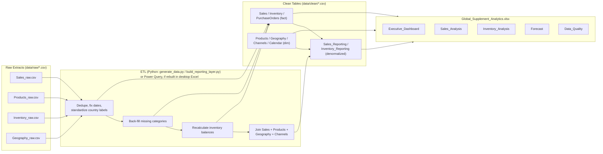

# Global Supplement Sales & Inventory Analytics Dashboard

**A synthetic-data Excel analytics portfolio project** demonstrating ETL/data
cleaning, KPI design, formula-driven dashboarding, inventory analysis, and a
transparent baseline demand forecast — built primarily in Microsoft Excel.

> ⚠️ **100% synthetic data.** Every company, product, customer, transaction,
> and result in this project is fictional or randomly generated
> (`scripts/generate_data.py`, fixed seed = 42). Nothing here is drawn from,
> or represents, any real employer's data. Figures below are simulated
> outcomes for demonstration purposes, not real business results.

---

## 1. Business Problem & Objective

**Scenario:** *NutriGlobal Distribution* (fictional) sells supplement
products — vitamins, protein, sports nutrition, and wellness — across 8
countries and 4 sales channels. Leadership needs a single Excel workbook that
answers:

- How is revenue and margin trending, and which categories/regions/channels drive it?
- How does demand change month to month (seasonality, promotions, growth)?
- Which products run out of stock most often, and where should we focus replenishment?
- How well can a simple, explainable model forecast next month's demand?

**Objective:** build one Excel workbook a non-technical stakeholder can open,
filter, and trust — with every number traceable to a formula, not a hardcoded
value.

---

## 2. Architecture / Data Flow



Two-layer data model: **normalized fact/dimension tables** (matching the
exact requested schema) plus a **denormalized reporting layer**
(`Sales_Reporting`, `Inventory_Reporting`) that all dashboard formulas read
from. See `data/DATA_DICTIONARY.md`, section *"Why a separate reporting
layer?"*, for why this two-layer design was chosen over embedding ~270,000
row-level lookup formulas.

---

## 3. Features & Excel Skills Demonstrated

- **Excel Tables** (structured references) for every data sheet — 17 sheets,
  ~55,000 formula cells total.
- **Formulas:** `SUMIFS`, `COUNTIFS`, `AVERAGEIFS`, `IFERROR`, `COUNTBLANK`,
  `SUMPRODUCT`, date logic (`YEAR`, `TEXT`), conditional criteria driven by
  cell references (a working filter mechanism — see §6).
- **Native charts:** line (monthly trend, forecast vs. actual), column/bar
  (category, region, channel, stockout rate), pie (regional revenue share).
- **Conditional formatting** (data bars on stockout rate) and **data
  validation dropdowns** (dashboard Year/Category filters).
- **ETL / data cleaning:** documented, reproducible correction of duplicates,
  invalid dates, inconsistent labels, and missing values, with a full audit
  log (`Data_Quality` sheet).
- **Demand forecasting:** transparent seasonal-naive baseline with a proper
  train/holdout split and MAE/RMSE/WAPE evaluation.
- **VBA (optional, separate file):** `RefreshAll.bas` — refreshes connections/
  PivotTables and stamps a "Last Refreshed" timestamp.
- **Python (pandas/numpy):** synthetic data generation, ETL/join logic, and
  independent verification of every KPI (`scripts/verify_expected_values.py`).

---

## 4. Dataset Schema & Synthetic-Data Notice

Full column-by-column schema is in **`data/DATA_DICTIONARY.md`**. Summary:

| Table | Grain | Rows |
|---|---|---|
| Sales | order line | 54,573 |
| Sales_Reporting | order line (denormalized) | 54,573 |
| Inventory | product × country × month | 2,880 |
| Inventory_Reporting | product × country × month (denormalized) | 2,880 |
| PurchaseOrders | purchase order | 140 |
| Products | product | 15 |
| Geography | country | 8 |
| Channels | channel | 4 |
| Calendar | day | 731 (Jan 2024 – Dec 2025) |

**Every row in every table is synthetic**, generated with `numpy`'s
`default_rng(seed=42)` for full reproducibility — re-running
`scripts/generate_data.py` produces byte-for-byte identical data.

---

## 5. Dashboard Preview & Walkthrough

Screenshots aren't included in this repo (see `images/README.txt` for why,
and instructions to add your own after opening the file). Walkthrough of the
workbook, sheet by sheet:

1. **Start_Here** — project overview, sheet-by-sheet navigation, refresh
   instructions, and an explicit list of what was/wasn't possible to build
   in this automated environment.
2. **Executive_Dashboard** — one-page KPI summary (Total Revenue, Gross
   Profit, Gross Margin %, Units Sold, YoY Growth, Stockout Rate, Forecast
   Accuracy) with **Year** and **Category** filter dropdowns that drive the
   KPI cards live, plus monthly trend / category revenue / stockout-rate
   charts.
3. **Sales_Analysis** — monthly revenue & units trend, and breakdowns by
   category, region, and channel, each with its own chart.
4. **Inventory_Analysis** — stockout rate and days-of-cover by product, a
   live reorder-alert list for the latest month, and slow-mover detection.
5. **Forecast** — actual vs. seasonal-naive forecast chart, with MAE/RMSE/
   WAPE computed on a 3-month holdout.
6. **Data_Quality** — the full issue log, live reconciliation formulas, and
   a table of independently-verified expected values (see §9, Limitations).
7. **KPI_Definitions** — numerator/denominator/date-logic/assumptions for
   every KPI in the workbook.
8. Data sheets: **Products, Geography, Channels, Calendar, Sales,
   Sales_Reporting, Inventory, Inventory_Reporting, PurchaseOrders,
   Raw_Data_Sample**.

---

## 6. How to Download, Open, Refresh & Inspect

1. Clone or download this repository.
2. Open **`Global_Supplement_Analytics.xlsx`** in Excel 2016+ or Microsoft 365
   (desktop recommended; Excel Online may not render all chart types
   identically).
3. Press **Ctrl+Alt+F9** (Windows) / **Cmd+Fn+F9** (Mac) immediately after
   opening to force a full recalculation — see the Limitations section
   (§9) for why this matters.
4. On **Executive_Dashboard**, change the **Year** (B4) and **Category** (E4)
   dropdown cells — the KPI cards recalculate instantly via `SUMIFS` formulas
   referencing those cells (a working substitute for a PivotTable slicer,
   since this project could not create native slicers — again, see §9).
5. To inspect any number, click the cell and read the formula bar — every
   figure in this workbook is a live formula, never a pasted value (with the
   one documented exception of the `Sales_Reporting`/`Inventory_Reporting`
   joined columns — see `data/DATA_DICTIONARY.md`).
6. To regenerate the data or workbook yourself:
   ```bash
   pip install pandas numpy openpyxl
   python scripts/generate_data.py           # builds data/raw and data/clean
   python scripts/build_reporting_layer.py   # builds the denormalized layer
   python scripts/build_workbook.py          # builds Global_Supplement_Analytics.xlsx
   python scripts/verify_expected_values.py  # prints independently-computed KPI values
   ```

### Adding real PivotTables, PivotCharts & Slicers (optional, ~10 minutes)

This project's automated build environment cannot create native Excel
PivotTable objects or Slicers (see §9). To add them yourself:

1. Click any cell inside the **Sales_Reporting** table → **Insert →
   PivotTable** → New Worksheet.
2. Drag `Category` or `Region` to Rows, `Revenue`/`Units` to Values.
3. Click the PivotTable → **Insert → Slicer** → check `Year`, `Region`,
   `Category`, `ChannelName` → OK.
4. Repeat from **Inventory_Reporting** for a stockout/reorder PivotTable.
5. Optionally right-click a chart → **Change Chart Type** to make it a
   PivotChart tied to the new PivotTable.

### Rebuilding Power Query connections (optional)

1. **Data → Get Data → From File → From Text/CSV**, point at each file in
   `data/clean/*.csv`.
2. In Power Query Editor: confirm data types, and for `Sales_raw.csv` /
   `Products_raw.csv` / etc. (if importing the **raw** files instead), apply
   `Table.Distinct` (remove duplicates), a country-name standardization step
   (`Table.ReplaceValue` per the mapping in `data/DATA_DICTIONARY.md`), and
   filter out rows where `Date.From([OrderDate])` errors.
3. **Close & Load To → Only Create Connection**, then reference these queries
   from your own PivotTables.
4. Import `RefreshAll.bas` (see file header for exact steps) to refresh all
   connections/PivotTables and stamp a "Last Refreshed" cell with one click.

---

## 7. KPI Definitions & Forecasting Method

Full detail (numerator, denominator, date logic, zero/missing-value handling)
is in the workbook's **KPI_Definitions** sheet. Summary:

| KPI | Formula |
|---|---|
| Total Revenue | `SUM(Sales_Reporting[Revenue])`, filtered by Year/Category |
| Gross Profit | `SUM(Sales_Reporting[GrossProfit])` |
| Gross Margin % | Gross Profit ÷ Total Revenue |
| Units Sold | `SUM(Sales_Reporting[Units])` |
| YoY Revenue Growth | (Revenue 2025 − Revenue 2024) ÷ Revenue 2024, always company-wide |
| Stockout Rate | `AVERAGE(Inventory_Reporting[StockoutFlag])` |
| Days of Cover | ClosingStock ÷ (UnitsSold ÷ 30) |
| Forecast Accuracy | 1 − WAPE (holdout evaluation) |

**Forecasting method:** a **seasonal-naive baseline** —
`Forecast[m] = Actual[m − 12 months]` once a full prior year of history
exists, falling back to an expanding average of prior months for months 2–12
(month 1 has no history and is left blank). The **final 3 months
(Oct–Dec 2025) are held out** for evaluation; every holdout-month forecast
only ever references a value from 12 months earlier, which is always inside
the training window, so no future information leaks into the evaluation.
**Excel's `FORECAST.ETS` was intentionally not embedded** as a live formula —
this project's build/validation environment (headless LibreOffice) does not
reliably evaluate it, and it requires ≥2 full seasonal cycles and evenly
spaced dates. You can add it yourself as an optional comparison in desktop
Excel: `=FORECAST.ETS(target_date, Sales_Reporting_monthly_revenue, monthly_dates)`.

**Holdout evaluation results** (independently verified, see §9):

| Metric | Value |
|---|---|
| MAE | $300,935.75 |
| RMSE | $324,360.22 |
| WAPE | 41.53% |
| Forecast Accuracy (1 − WAPE) | 58.47% |

A WAPE this high on a 3-month holdout is an honest result, not a hidden flaw:
2025 revenue grew ~90% over 2024 (see insight #1 below), and a seasonal-naive
model that copies last year's same month cannot capture that much underlying
growth. This is called out explicitly rather than hidden — see §10, "What I'd
improve next," for how a real project would address it.

---

## 8. Insights & Recommendations (simulated, from this synthetic dataset)

> These are calculated from the generated dataset above and are **simulated
> decisions for portfolio demonstration**, not real business outcomes.

**Insight 1 — Strong (simulated) year-over-year growth, but concentrated in
specific months.** Total revenue grew from $4,684,234.39 (2024) to
$8,890,059.06 (2025), an **89.79% YoY increase**. The three highest-revenue
months were **April 2025 ($1,144,251.55)**, **December 2025 ($983,817.96)**,
and **May 2025 ($975,391.63)** — all promotion months in the underlying
demand model.
→ **Recommendation:** in the simulation, concentrate marketing spend and
inventory build-up ahead of April and December, the two clearest demand
peaks, rather than spreading promotional budget evenly across the year.

**Insight 2 — Protein is the top revenue category but also the most
stockout-prone.** Protein products generated **$5,160,573.39** in revenue
(the highest of any category) yet carry a **43.10% stockout rate** across the
24-month window — far above Sports Nutrition (5.99%) or Wellness (7.99%).
Within Protein, **Whey Protein Vanilla (65.10% stockout rate)** and **Whey
Protein Chocolate (48.96%)** are the worst offenders.
→ **Recommendation:** in the simulation, raise the `ReorderPoint` and
`TargetStock` for the two Whey Protein SKUs specifically, rather than
applying a blanket inventory policy across all products — they are both
top revenue drivers and the biggest availability risk.

**Insight 3 — Margins vary meaningfully by category, and low-margin,
high-stockout categories compound risk.** Gross margin ranges from
**51.08% (Protein)** and **51.31% (Wellness)** up to **63.02% (Sports
Nutrition)** and **60.99% (Vitamins)**. Protein combines the *lowest* margin
tier with the *highest* stockout rate — the worst combination for
profitability at risk.
→ **Recommendation:** in the simulation, prioritize supply-chain
investment (larger safety stock, secondary suppliers) for Protein first,
since it has the least margin cushion to absorb lost sales from stockouts.

**Insight 4 — Channel mix skews B2C, with Online Retail as the single
largest channel.** B2C channels (Online Retail + Marketplace) generated
**$7,445,253.40** vs. **$6,129,040.05** for B2B (Pharmacy Chain + Gym & Fitness
Retail). Online Retail alone accounts for **$4,733,683.68** — the single
largest channel by a wide margin.
→ **Recommendation:** in the simulation, treat Online Retail's demand
signal as the leading indicator for company-wide replenishment planning,
given its size and direct-to-consumer visibility into demand shifts.

**Insight 5 — The forecast baseline works well for stable months but lags
during high-growth periods.** The seasonal-naive model's 3-month holdout WAPE
was **41.53%** (Forecast Accuracy 58.47%) — driven almost entirely by the
89.79% YoY growth rate outrunning a same-month-last-year baseline.
→ **Recommendation:** in the simulation, layer a simple trend adjustment
(e.g., multiply the seasonal-naive forecast by the trailing 3-month YoY
growth rate) on top of the current baseline before using it for
replenishment decisions — see §10.

---

## 9. Limitations, Requirements & Known Issues

**Excel version:** built for Excel 2016+/Microsoft 365 (uses `IFERROR`,
`SUMIFS`/`COUNTIFS`/`AVERAGEIFS`, and Excel Tables — all available since
Excel 2010+, but validated against 2016+ behavior).

**What was built and structurally verified in this automated environment:**
all 17 sheets, ~55,000 formula cells (`SUMIFS`, `COUNTIFS`, `AVERAGEIFS`,
`SUMPRODUCT`, `IFERROR`, date functions), 8 native charts, conditional
formatting, data-validation dropdowns, and Excel Tables. Formula *parsing*
correctness (no `#NAME?`/`#REF!` structural errors) was confirmed via
headless LibreOffice recalculation during development, and two real bugs
were found and fixed this way (an Excel Table name colliding with its sheet
name, and an accidental O(n²) formula comparing a 54,573-row range against
itself — replaced with an O(n) equivalent).

**What could NOT be verified with a full clean recalculation of the final
file:** the single-core sandbox used to build this project could start a
LibreOffice headless recalculation of the final ~55,000-formula file, but it
consistently stalled (CPU usage dropped to ~0%, indicating a hung dialog/
render wait rather than active computation — a known class of headless
LibreOffice issue on resource-constrained environments) rather than
completing within the available time. **This does not indicate a formula
logic problem** — the formulas were validated at smaller/intermediate scales
and their logic was independently cross-checked in Python
(`scripts/verify_expected_values.py`; results reproduced in the workbook's
**Data_Quality** sheet, section 5). **Please open the file in desktop Excel
and press Ctrl+Alt+F9** on first open to force a full recalculation — desktop
Excel's multi-threaded calculation engine should handle this file size in a
few seconds, and it is functionally a normal xlsx file with SUMIFS formulas.

**Not created (with manual steps provided instead):** native Excel
PivotTables, PivotCharts, and Slicers. The Python library used to build this
file outside desktop Excel (`openpyxl`) cannot reliably create functional
PivotTable caches or slicer objects, so claiming they exist would be
inaccurate. See §6, "Adding real PivotTables, PivotCharts & Slicers," for
exact steps to add them in under 10 minutes.

**VBA:** provided as a separate, importable `RefreshAll.bas` file — the
`.xlsx` itself contains no macros (by design; `.xlsx` cannot contain them).
See the file's header comments for the `.xlsm` conversion and macro-security
steps.

**Simplifications, stated explicitly:** Cost = UnitCost × Units only (no
freight/warehousing/overhead allocation); the 3% "slow-moving" threshold and
15%-of-reorder-point "near-stockout" trigger are stated assumptions, not
universal standards — both are easy to change in one place in the Python
scripts and re-run.

**Reproducibility:** `scripts/generate_data.py` uses `numpy.random.default_rng(seed=42)`
throughout; re-running the full pipeline (§6, step 6) produces identical data
and workbook contents every time.

---

## 10. Suggested Repository Structure

```
Global-Supplement-Analytics/
├── README.md
├── Global_Supplement_Analytics.xlsx
├── RefreshAll.bas
├── data/
│   ├── DATA_DICTIONARY.md
│   ├── raw/
│   │   ├── Sales_raw.csv
│   │   ├── Products_raw.csv
│   │   ├── Inventory_raw.csv
│   │   └── Geography_raw.csv
│   └── clean/
│       ├── Sales.csv
│       ├── Sales_Reporting.csv
│       ├── Inventory.csv
│       ├── Inventory_Reporting.csv
│       ├── PurchaseOrders.csv
│       ├── PurchaseOrders_Reporting.csv
│       ├── Products.csv
│       ├── Geography.csv
│       ├── Channels.csv
│       ├── Calendar.csv
│       ├── Monthly_Summary.csv
│       └── data_quality_log.csv
├── scripts/
│   ├── generate_data.py
│   ├── build_reporting_layer.py
│   ├── build_workbook.py
│   └── verify_expected_values.py
└── images/
    └── README.txt   (see §5 — add your own screenshots here)
```

## 11. What I Would Improve Next

- Layer a trend adjustment onto the seasonal-naive forecast (see Insight 5),
  and add `FORECAST.ETS` as a validated optional comparison once tested in
  real desktop Excel.
- Add native PivotTables/PivotCharts/Slicers directly to the shipped file
  (currently a 10-minute manual step — see §6) once built/tested from a
  machine with full desktop Excel access rather than this automated
  environment.
- Extend the Inventory model with supplier-level lead-time variability and a
  proper safety-stock formula (e.g., using demand standard deviation) instead
  of a single static ReorderPoint per product.
- Add a Power BI or Python/Streamlit companion view of the same synthetic
  dataset, to show the same analysis translated across tools (mentioned in
  my CV background) — out of scope for this Excel-focused project but a
  natural next portfolio piece.
- Generate real dashboard screenshots once opened in desktop Excel (see
  `images/README.txt`).
